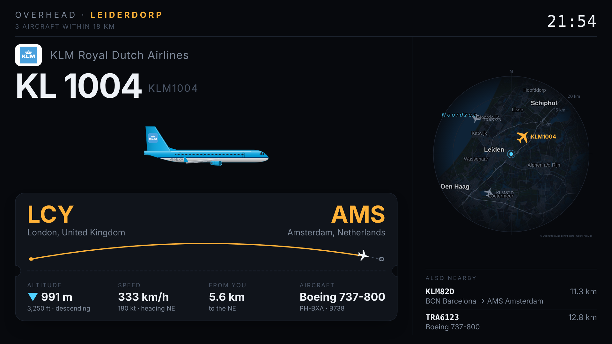
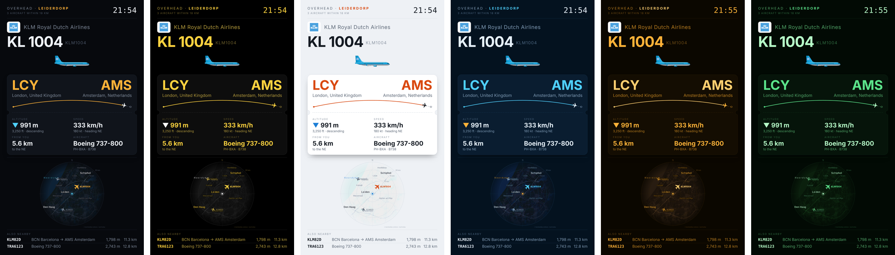
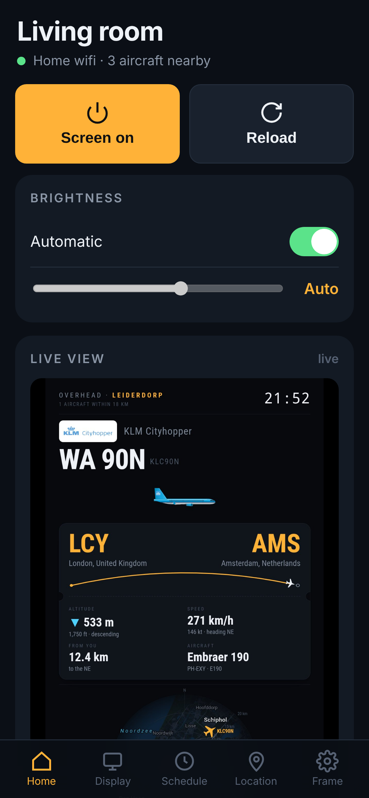
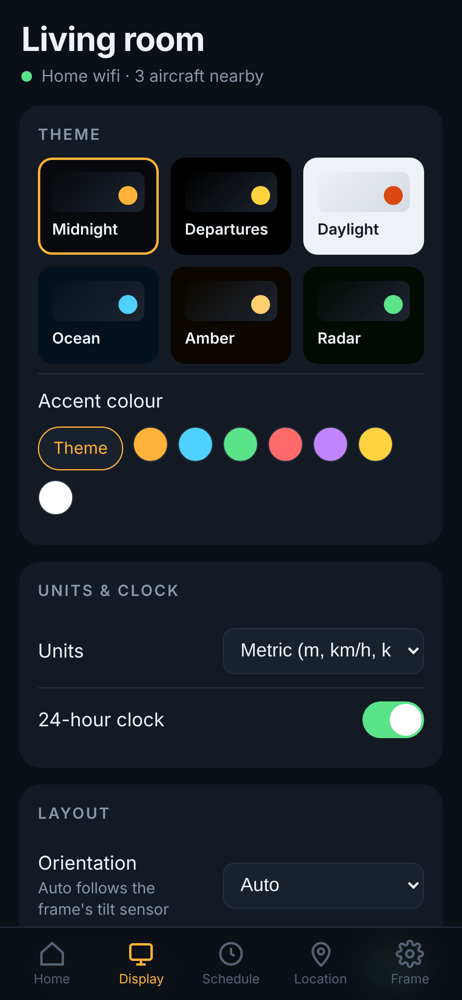
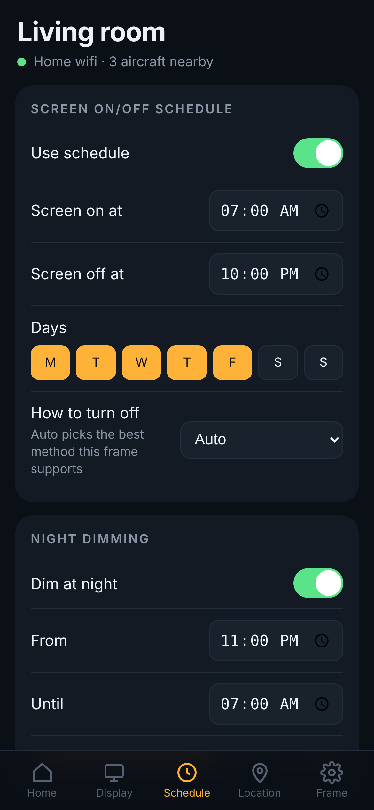
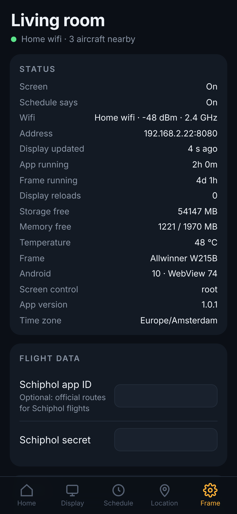

# ✈ Flight Frame

**Turn a cheap Android photo frame into a live display of the planes flying over your home.**

Flight Frame shows the nearest aircraft with its airline, flight number, route, a drawing of the actual aircraft type, altitude, speed and distance, plus a radar map of everything around you. When the sky is empty it shows the time, weather, a rain chart, sunrise/sunset and the next space-station pass. You control it all from a phone app.

<p align="center">
  
</p>

<p align="center">
  
</p>

## What's in the box

| | |
|---|---|
| **Display** (`display/`) | The page the frame shows. Live data, airline colours on the plane drawings, route arc, radar with a map of your area, empty-sky screen. Metric, imperial or aviation units. Six themes. |
| **Frame app** (`app/`) | A small kiosk app (no Google Play needed): full screen, starts on boot, keeps the screen on, restarts the display if it ever freezes, turns the screen off and on by schedule, and runs the phone-control server. Replaces Fully Kiosk. |
| **Phone app** (`companion/`) | Served by the frame itself — open it in your phone's browser and *Add to Home Screen*. Screen on/off, brightness, live view of the frame, themes, units, layout, schedule, night dimming, location search, radar map upload, Schiphol keys, status, backup/restore, PIN. |
| **Tools** (`tools/`) | One-command installer for Mac/Linux (`install.sh`) and Windows (`install.ps1`), and `make_map.py` to make the radar map for any location. |

<p align="center">
     
</p>

## What you need

- **A photo frame running full Android** where you can turn on *USB debugging* or *ADB*. Tested: **Arktronic AK-W215B** (21.5", 1920×1080, Android 10). Frameo frames usually work too (Settings → About → Beta program → ADB access). See **[docs/HARDWARE.md](docs/HARDWARE.md) · Website: https://anguslemoine-maker.github.io/FlightFrame/** before buying.
- A Mac, Windows or Linux computer for the 5-minute install (only once).
- Wifi. No accounts, no subscriptions.

## Install

1. On the frame: enable **Developer options → USB debugging** (and *ADB over network* if offered). Note the frame's IP address (Settings → Wi-Fi).
2. Download the latest **[release](../../releases/latest)**: `FlightFrame.apk`, `install.sh` / `install.ps1` into one folder.
3. Run the installer:
   - Mac / Linux: `bash install.sh 192.168.1.50`
   - Windows: `powershell -ExecutionPolicy Bypass -File install.ps1 192.168.1.50`
   (use your frame's address, or leave it out if the frame is plugged in by USB)
4. On your phone, open the address the installer prints (e.g. `http://192.168.1.50:8080`) → **Add to Home Screen**.
5. In the phone app, go to **Location**, search for your town, and you're done.

### Your own radar map
The map under the radar is made for one location. For yours:
```bash
pip install mapbox-vector-tile pillow
python3 tools/make_map.py --lat 40.7128 --lon -74.0060 --out mymap
```
Then upload `radarmap.jpg` and `radarmap.js` in the phone app (**Location → Radar map**). Edit the place names in `radarmap.js` if you like.

### Optional: Schiphol schedule (Netherlands)
With a free key from [developer.schiphol.nl](https://developer.schiphol.nl) (Flight API, client-credentials), flights to and from Amsterdam get their official route and flight number. Enter the client ID and secret in the phone app (**Frame → Flight data**).

## Build the app yourself
GitHub builds the app automatically (Actions → *Build app*). Locally you need JDK 17 and the Android SDK (`platforms;android-29`, `build-tools;34.0.0`) — no Gradle:
```bash
ANDROID_SDK=~/Android/sdk bash app/build.sh
```
To keep the same signature for updates, add your keystore as the repository secret `KEYSTORE_B64` (`base64 -i flightframe.keystore`).

## Phone-control API
The frame app listens on port 8080 (your home network only). `GET /api/state`, `POST /api/settings` (partial JSON), `POST /api/action` (`screen_on`, `screen_off`, `reload`, `restart`, `identify`, `update`, `clear_cache`, `reboot`, `reset`), `GET /api/screenshot.jpg`, `POST /api/file?name=radarmap.jpg`, `GET /api/backup`, `POST /api/restore`, `GET /api/log`. If you set a PIN, send it as the `X-PIN` header. Handy for Home Assistant: e.g. a `rest_command` that turns the screen off when you leave home.

## Where the data comes from
All free, no keys needed (except the optional Schiphol one):
- **Aircraft positions:** [adsb.lol](https://adsb.lol) — community ADS-B network (ODbL)
- **Routes & aircraft details:** [adsbdb.com](https://www.adsbdb.com) and [hexdb.io](https://hexdb.io), cross-checked against the plane's live position and heading
- **Official Schiphol schedule:** [Schiphol Flight API](https://developer.schiphol.nl) (optional)
- **Weather:** [Open-Meteo](https://open-meteo.com) (CC BY 4.0) · **Space station:** [CelesTrak](https://celestrak.org) + satellite.js
- **Map:** © [OpenStreetMap](https://www.openstreetmap.org/copyright) contributors, via [OpenFreeMap](https://openfreemap.org)
- **Airline logos:** loaded at runtime from public logo services; they remain the property of their owners.

Routes from free databases are occasionally out of date. Please use the data for fun, not for anything safety-related.

## Credits
Plane drawings, map styling, the app and the phone app are original work released under the MIT License. Flight Frame is an independent hobby project and isn't affiliated with any airline, airport, frame maker, or with other flight-display products.
